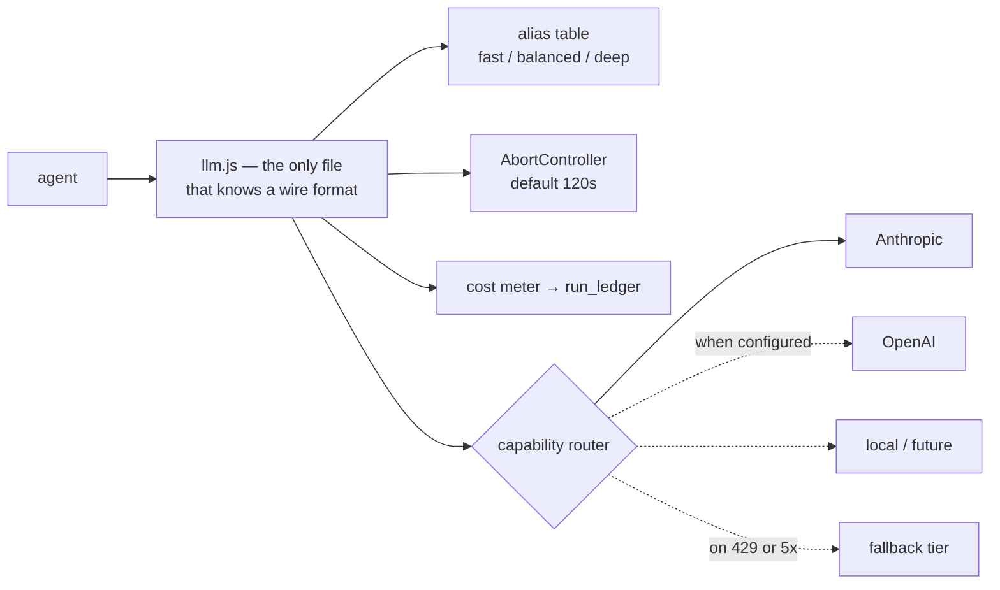

# PlayNexa — AI Provider Fabric

**Date:** 2026-10-27 · §11 and §32 of the CEO brief · **Verdict: BROKEN as an abstraction**

---

## Current state, measured

**Nineteen Anthropic call sites. Eight use the shared wrapper. Eleven hand-roll the same fetch**, each with its own local `callClaude` shadowing the shared one — including **two inline inside HTTP route handlers** (`routes.js:1628`, `routes.js:3652`).

`src/lib/llm.js:3-5` claims the duplication was centralised. It was not; the eleven copies remain.

There is no provider abstraction of any kind. Anthropic's wire format is hardcoded at nineteen places: the URL, `x-api-key`, `anthropic-version: '2023-06-01'`, the `messages[]` shape, and Anthropic-specific response parsing. `package.json` has no `@anthropic-ai/sdk` — every call is raw `fetch`. **Swapping or failing over to another provider means editing nineteen files.**

### Model pins have already drifted

| Model | Sites | Note |
|---|---|---|
| `claude-opus-4-8` | 8 | the de-facto default |
| `claude-opus-4-7` | 1 | `growth-agent.js:243` — stale, one minor behind its siblings |
| `claude-sonnet-5` | 3 | |
| `claude-sonnet-4-6` | 1 | `routes.js:3656` — stale, inline in a route handler |
| `claude-haiku-4-5-20251001` | 3 | the only date-qualified pins |

Four families, two stale, no central constant. The cost table at `llm.js:29-35` lists rates for `claude-fable-5` and `claude-mythos-5` — **models no call site uses** — and `llm.js:39` silently bills any unrecognised id at opus rates, so a drifted pin is also a mispriced one.

Image generation already has what text generation lacks: a three-tier fallback chain (`gpt-image-1` → `dall-e-3` → `dall-e-2`, `linkedin-agent.js:359-375`) with `isModelError` deliberately excluding 401/429/400 so a quota error fails hard rather than silently downgrading. That is the right shape, and it exists only for images.

### The dangerous omission

**`llm.js:60` has no timeout and no `AbortController`.** Its sibling `outbound/http.js:4` names the gap explicitly: *"PLUS the timeout llm.js lacks."* Every AI call in the system can hang indefinitely, inside a cron that has no timeout either, with `withAlerts` only firing on a throw. **A hung Claude call is invisible to every monitor in the system.**

No retries anywhere, for any provider. No outbound 429 detection, no `Retry-After` parsing, no backoff, no quota tracking.

---

## Target

Four changes, in order:

**1. Collapse the eleven hand-rolled fetches into `llm.js`.** Mechanical, low risk, and the prerequisite for everything else. The two inline calls in route handlers go first — they are the least visible.

**2. Add the `AbortController`.** Half a day, closes the invisible-hang hole. This is P0 in the implementation plan and does not wait for the rest.

**3. Replace literal model ids with capability aliases.** `fast` / `balanced` / `deep` resolved through one table, so a pin change edits one line and a drifted pin becomes impossible. Keep the literal id in the audit row so a past decision stays explicable.

**4. Add the router.** `capability + data-classification → provider`. Only once 1–3 are done, because a router over nineteen call sites is a router over nothing.

---

## What is real and what is assumed, per §32

The brief says not to assume a provider capability exists because it appears in a consumer application. Stating it plainly:

| Capability | Status |
|---|---|
| Anthropic Messages API | **Real.** Nineteen call sites against the documented HTTP API. |
| OpenAI image generation | **Real.** `/v1/images/generations` and `/v1/images/edits`, with a fallback chain. |
| OpenAI text/agents | **Not integrated.** No call sites. |
| Claude Code as a programmatic worker | **Not integrated.** It is a developer tool used by a human in this repository, not a service PlayNexa calls. |
| Claude Cowork / ChatGPT "connected apps" | **No supported programmatic interface is in use here.** Driving a consumer UI is explicitly out of scope per §32, and nothing in the repo attempts it. |
| Local models | **Absent.** No runtime, no adapter. |

So the provider fabric today is: **one provider for text, one for images, both via raw HTTP, with no failover.** Any claim beyond that would be aspiration.

---

## Cost control

Token accounting exists where the shared wrapper is used — `llm.js:41-45` computes `costUsd` from `usage` against the rate table, deliberately using undiscounted list prices so estimates over-shoot. **The eleven inline call sites bypass it entirely and record nothing.**

Exactly one enforced cap exists: `RESEARCH_INTEL_DAILY_USD_CAP`, default **$2.00**, checked before each study (`research-intelligence/index.js:183-189`). That is a well-built fuse on one subsystem.

Nothing else is capped. The permission registry carries a `spend: []` field on every feature and `contract.js` a `costClass` per agent — **neither is read by any enforcement path**. `gate.js:12-13` states the position outright: *"No spend enforcement yet (cost is recorded, not capped)"* — and since the gate is never called, even the recording never happens.

**Until cost lands in `run_ledger` and is summed, §21 of the brief — agent economics — is not merely unimplemented, it is unmeasurable.**
