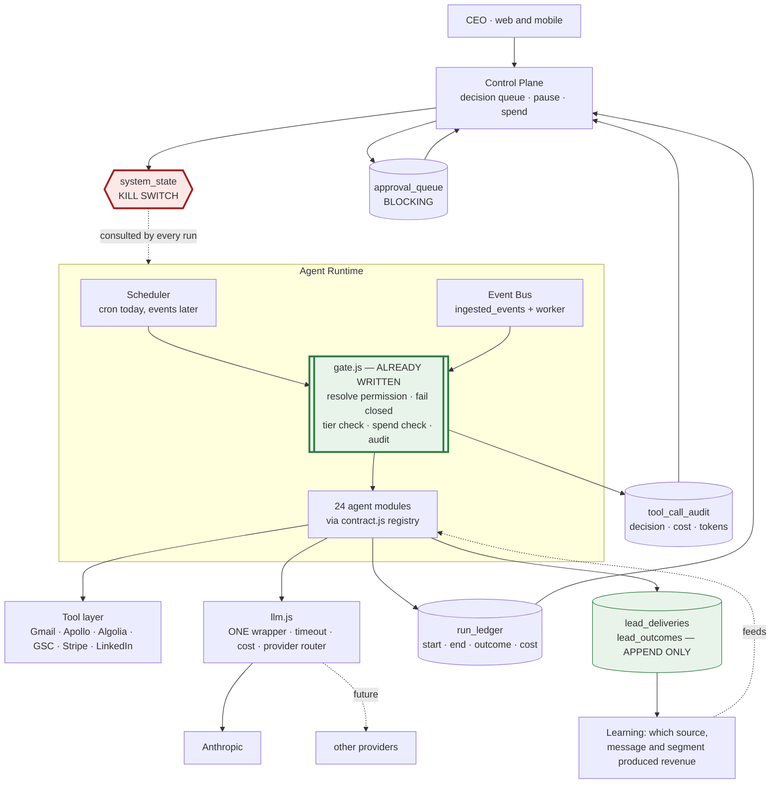

# PlayNexa — Target Architecture

**Date:** 2026-10-27 · The smallest architecture that makes the CEO brief's vision safe, not the largest that matches its diagram

---

## The governing decision

**Do not build a new control plane. Wire the one that is already written.**

The audit found `contract.js`, `gate.js`, `permissions/registry.js`, `migrate-lead-outcomes.js` and `outbound/http.js` to be careful, tested, documented — and called by between 0 and 8 of their potential call sites. The distance from the current system to a governed one is mostly **adoption**, not design.

Three things genuinely do not exist and must be built: a **kill switch**, a **run ledger**, and an **event spine**. Everything else on this page is connecting existing parts.

---

## Target shape



Green = already written, needs calling. Red = does not exist, must be built.

---

## 1. Kill switch — NEW, and the precondition for everything else

A single `system_state` table with rows at four scopes: `global`, `company`, `agent`, `campaign`. Every scheduled run consults it **before** doing work, and `withAlerts` is the natural place because all 41 crons already pass through it.

```
withAlerts(name, fn) →  paused(name)?  →  skip + log, do not alert
                                       →  else run
```

Three properties that matter:

- **It must take effect without a redeploy.** That is the entire point, and it is why this is a database row rather than another env flag. The 12 October incident is the proof: `process.env` is captured at launch.
- **A pause is not a failure.** It logs and returns; it must not email an alert, or pausing becomes noisy and people stop doing it.
- **Resume must be explicit.** No auto-expiry. A paused agent stays paused until somebody says otherwise.

Granularity follows the vision's §23 exactly: pause all, pause company, pause agent, pause campaign. Credential revocation is a later addition and depends on the broker.

## 2. Governance spine — EXISTS, call it

`gate.js` already resolves permission, fails closed on resolver error, writes one `tool_call_audit` row per call with decision, rule, cost, tokens, latency and idempotency key, and never throws. Adoption is:

1. Register the 24 agents in `contract.js` (currently 2).
2. Replace direct `require` + call in `server.js` crons with `callAgent(name, input, ctx)`.
3. Run `scripts/migrate-tool-audit.js` — currently *"NOT wired into boot"*.
4. Add the **autonomy tier** to each registry entry and have `gated()` consult `isHighImpact()` for Tier 2+, and `approval_queue` for Tier 3.

That last step is what turns the approval queue from a to-do generator into a gate. The pattern already exists and works: `procurement-agent.js:271-291` selects only `status='approved'` rows before acting. Generalise that, do not reinvent it.

**Agents that read external text go first** — `inquiry-agent`, `meet-agent`, `prospecting`, `research-intelligence` — because they are the prompt-injection surface and they currently hold unrestricted database privilege.

## 3. Run ledger — NEW

`mission-control` currently derives agent status by string-matching `output_summary` for `'%error%'`, so an agent that fails before it logs is invisible and "running" dies with the container.

One table, written at start and at end:

```
run_ledger: id, agent, started_at, finished_at, outcome(ok|failed|paused|timeout),
            items_processed, items_skipped, cost_usd, error, trigger(cron|manual|event)
```

This is what makes §20 (observability) and §21 (agent economics) answerable. `cost_usd` summed over this table is the answer to "what did the platform spend yesterday", which today has no answer at all.

## 4. Provider router — EXISTS as `llm.js`, needs adoption and a timeout

Nineteen Anthropic call sites; eight use the shared wrapper; eleven hand-roll the same fetch, two of them inline in HTTP route handlers. Model pins have drifted into four families, two stale.

Target: `llm.js` is the only file that knows a provider's wire format. It gains an `AbortController` (it has none today — the single most dangerous omission in the runtime, because a hung call hangs its cron with every monitor green), a model alias table so pins live in one place, and a `capability → provider` map. Swapping or failing over then edits one file instead of nineteen.

This is §11 of the brief, and it is a refactor rather than an architecture.

## 5. Event spine — NEW, but half-built

`ingest.js` is already a good sink: bearer secret per source, product derived from the credential rather than the payload, payload-hash idempotency, reject-vs-quarantine semantics. It is flag-gated off and **has no consumer**.

The missing half is a worker that reads `ingested_events` and dispatches through `gate.js`. Start with one event that matters — `CUSTOMER_REPLIED` — and keep the hourly poller as the fallback rather than replacing it. The poller is not wrong; it is just slow, and a reply sitting unseen for an hour is the business cost.

Postgres `LISTEN`/`NOTIFY` is sufficient at this volume. A broker is a P3 decision.

## 6. Data isolation — change the shape, not the design

The product boundary's design is sound; its placement is not. It resolves the product from the **route**, so a shared endpoint can return rows from several businesses.

Target: a `product` column on every table that holds business data, set on write, filtered on read, with `PRODUCT_BOUNDARY_MODE=enforce`. The migration is mechanical and large. **This is the single biggest piece of work in the plan**, and it is the only honest route to "data must not casually leak between companies."

## 7. Learning loop — EXISTS, connect both ends

`lead_deliveries` / `lead_outcomes` is the best-designed schema in the repo: `reason NOT NULL`, append-only enforced by a trigger, current state derived by view. Its only writer is a human typing a CLI flag.

Both ends need wiring: the outreach agent should write a delivery when it sends, and the reply classifier should append an outcome when someone answers. Then one consumer — the scoring that decides which segment to send to next — reads `lead_current_state`. Until something reads it, it is bookkeeping.

---

## What this architecture deliberately does not include

**An Executive Agent that converts objectives into coordinated work (§5).** Not because it is undesirable, but because it is the capability most likely to produce confident, wrong action, and the system currently has no tiering, no spend ceiling, no kill switch and no outcome data to learn from. Build it after those exist, not before.

**A general workflow engine.** One already works for campaigns. Generalising it before a second real use case exists would be designing against imagination.

**The Mac mini edge node.** See `MAC_MINI_EDGE_NODE.md` — it is P3, and nothing in the revenue loop needs it.

**Replacing the cron scheduler.** Timers are a legitimate trigger. The gap is that they are the *only* trigger; adding events does not require removing clocks.

---

## Sequencing principle

Every step must leave the system safer than it found it, and no step may increase what agents can do before increasing what can stop them.

That gives a strict order: **kill switch → run ledger → gate adoption → tiering → spend ceiling → events → isolation → learning.** The implementation plan follows it.
