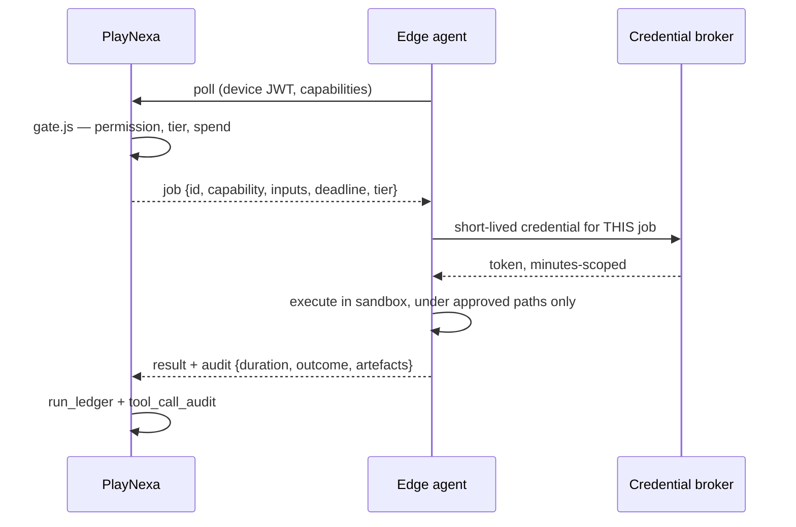

# PlayNexa — Mac mini Edge Node

**Date:** 2026-10-27 · §12, §13 and §31 of the CEO brief · **Current status: does not exist** · **Recommended priority: P3**

---

## The recommendation first

**Do not build this yet.** Nothing in the Abiozen revenue loop needs it, and building it now adds a significant security surface to a system that currently has no kill switch, no autonomy tiering, no agent permission enforcement and no spend ceiling.

The brief's own §12 makes the strongest argument for deferring: *"critical workflows should NOT fail simply because the Mac mini loses power or Internet connectivity. Cloud-first workflows must continue independently whenever possible."* If that holds, then by construction the edge node carries only work that is **not** critical — which is the definition of something that can wait.

An edge node earns its place when there is work that genuinely cannot run in the cloud. Today that list is short and none of it is on the revenue path:

| Candidate work | Can it run in the cloud today? |
|---|---|
| Gmail / Calendar / Drive | **Yes** — service account with domain-wide delegation, already working |
| Outreach, ingest, classification, reports | **Yes** — all 41 crons run in Railway |
| Browser sessions needing a human's logged-in state | **No** — genuine edge work |
| Desktop apps with no API | **No** — genuine edge work |
| Label printing, local hardware | **No** — genuine edge work, when fulfilment starts |
| Local files not worth uploading | **No** — genuine edge work |

Three of those six become real when physical fulfilment starts. That is the trigger to build this, not now.

---

## When it is built: the design

Recorded so the decision does not have to be rediscovered.

### Identity and enrolment

`EDGE-US-CHI-001` as the device identity. Enrolment is a one-time operator-initiated exchange producing a device keypair; the private key never leaves the machine's Keychain. PlayNexa stores only the public key and a device record with capabilities, last heartbeat and status.

**No inbound connectivity.** The node polls or holds an outbound WebSocket. PlayNexa never connects to it, so a home or office NAT is not an obstacle and no port is exposed.

### Job dispatch

The job goes through `gate.js` like any other agent call. The edge node is **a worker, not a second control plane** — it never decides what to run.

### Security controls (§13)

Dedicated non-admin macOS account; FileVault; firewall with no inbound; automatic updates. **No long-lived credentials on the device** — every secret is fetched per job from the broker and expires in minutes. Approved-paths allowlist, denied by default. Audit shipped per job. Remote disable by revoking the device key, which must take effect on the node's next poll without needing the node to cooperate.

The most important rule, and the easiest to break: **do not leave the Mac logged in with every company password in a browser profile.** That turns one stolen laptop into total compromise, and it is the normal failure mode for machines like this.

### Offline behaviour

Jobs are leased with a deadline. An expired lease returns to the queue. The node holds no durable state the cloud needs. If it is off, edge-only jobs queue and everything else is unaffected — which is the property §12 asks for, and it only holds if cloud work never depends on the node.

---

## Dependencies

This design assumes three things that do not exist yet: the **credential broker** (P1 in the plan), **`gate.js` actually being called** (P0.5) and the **run ledger** (P0.3). Building the edge node before them would mean a device holding long-lived credentials and dispatching ungoverned work — the worst version of this.

**Build it after P0 and P1. Not before.**
